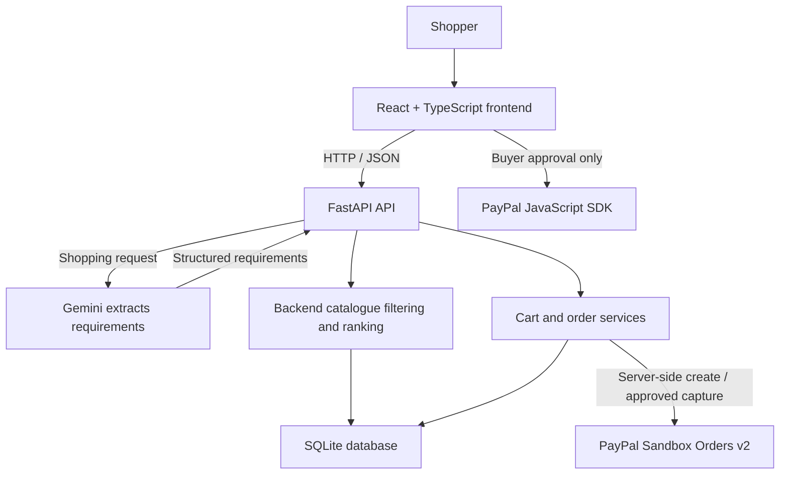

# ShopPilot AI

**Tell us what you need. Let AI find it. You decide. PayPal makes it happen.**

ShopPilot AI is a catalogue-backed shopping assistant prototype. Shoppers describe a need in natural language, review and compare products from a seeded SQLite catalogue, manage a guest cart, and can begin a PayPal Sandbox checkout. The AI helps extract requirements; the backend remains the source of truth for products, prices, stock, totals, and payment status.

> **Payment status:** PayPal Sandbox order creation is implemented. The reported buyer login/approval problem remains unresolved, and a successful end-to-end Sandbox capture has not been verified. Tests mock PayPal and do not make a payment. Do not treat order creation as payment success. Product details, stock, and ratings are demonstration data.

## Problem and solution

Shopping filters can be difficult to translate from everyday needs such as budget, intended use, and preferred features. ShopPilot accepts a natural-language request, extracts structured constraints with Gemini when configured, searches the actual product database, and ranks matching in-stock products. Customers make every comparison, cart, and checkout decision themselves.

**Target users:** shoppers exploring a small product catalogue and hackathon reviewers evaluating an AI-assisted commerce workflow.

## Features

- Product catalogue with category, search, price, and sort filters.
- Natural-language shopping assistant with structured requirement extraction.
- Gemini 3.1 Pro Preview through Google's official Python SDK; deterministic catalogue fallback when Gemini is disabled or unavailable.
- Database-grounded product filtering, ranking, comparison, and explanations.
- Guest cart with server-side product and stock validation.
- SQLite persistence for products, carts, and orders.
- Server-calculated checkout quote, INR-to-USD conversion, and PayPal Sandbox Orders v2 integration.
- Buyer approval is required before the frontend requests a server-side capture.
- Responsive React interface, FastAPI APIs, and generated OpenAPI documentation.

The Gemini model extracts requirements only. The backend performs the catalogue search and ranking; Gemini does not supply product names, prices, stock, or ratings. The current workflow uses structured output rather than Gemini's model-driven function-calling feature. Payment operations are separate backend endpoints and are never invoked by the AI.

## Agent workflow

1. A shopper describes a need, for example: “I need a laptop under ₹60,000 for Python and college.”
2. The frontend sends the current conversation context to the FastAPI assistant endpoint.
3. If Gemini is configured, the backend asks it for validated structured requirements: category, budget, minimum RAM, and keywords.
4. The backend filters active, in-stock SQLite products, applies category, budget, and RAM constraints, and ranks the actual catalogue records.
5. The assistant returns catalogue-backed products and explanations. If Gemini is unavailable, the response includes an `ai_warning` and uses deterministic parsing and recommendations.
6. The shopper chooses whether to compare products or add one to the cart.
7. The backend recalculates the checkout amount from database prices and the configured demo conversion rate.
8. The backend creates a PayPal Sandbox order. The buyer must approve it through PayPal before the frontend calls the capture endpoint.
9. The backend checks the returned order, capture status, currency, and amount before storing a completed order.

## Technology

| Area | Technologies |
|---|---|
| Frontend | React 18, TypeScript, Vite, Tailwind CSS, Axios, React Router, Lucide React |
| Backend | Python 3.11+, FastAPI, Pydantic, SQLAlchemy, HTTPX |
| Database | SQLite |
| AI | Google Gen AI Python SDK (`google-genai==3.2.0`), `gemini-3.1-pro-preview` |
| Payments | PayPal JavaScript SDK, PayPal Orders v2 Sandbox |
| Tests | pytest, FastAPI `TestClient`, mocked external services |

Gemini 3.1 Pro is a **Preview** model. Availability, quotas, and access are controlled by Google and the API key. See Google's [Gemini API model documentation](https://ai.google.dev/gemini-api/docs/models/gemini-3.1-pro-preview) and [Python SDK documentation](https://ai.google.dev/gemini-api/docs/libraries). This repository's tests mock the SDK; no real Gemini request has been performed as part of this verification.

## Architecture



The browser is not trusted to submit checkout prices. The backend reads product prices and stock, computes totals, keeps provider secrets server-side, and verifies capture responses. Guest session IDs are a demo cart/order scoping mechanism, not user authentication.

## Screenshots

There are no real application screenshots checked in yet. See [`screenshots/README.md`](./screenshots/README.md) for the capture list and guidance. Capture the home page, assistant, recommendations, comparison, cart, checkout, and order confirmation from the actual application. Do not use mockups or imply that an unverified payment succeeded.

## Repository structure

```text
.
├── backend/
│   ├── app/
│   │   ├── config.py
│   │   ├── database.py
│   │   ├── main.py
│   │   ├── models.py
│   │   ├── schemas.py
│   │   ├── seed.py
│   │   └── services.py
│   ├── tests/test_api.py
│   ├── .env.example
│   └── requirements.txt
├── frontend/
│   ├── src/
│   │   ├── components/
│   │   ├── context/
│   │   ├── pages/
│   │   ├── services/
│   │   ├── App.tsx
│   │   ├── index.css
│   │   └── types.ts
│   ├── .env.example
│   └── package.json
├── screenshots/README.md
├── CONTRIBUTING.md
├── DEMO_GUIDE.md
├── LICENSE
└── README.md
```

## Prerequisites

- Git
- Node.js 18 or later and npm
- Python 3.11 or later
- Optional: Gemini API key with access to `gemini-3.1-pro-preview`
- Optional: PayPal Developer Sandbox REST app and Sandbox Personal buyer account

## Installation and startup

Clone the repository:

```powershell
git clone https://github.com/dakshagupta908-cloud/shoppilot-ai-agentic-ai-shopping-assistant.git
cd shoppilot-ai-agentic-ai-shopping-assistant
```

Use two terminals from the repository root.

### Backend (Windows PowerShell)

```powershell
cd backend
py -3.11 -m venv .venv
.\.venv\Scripts\Activate.ps1
python -m pip install -r requirements.txt
if (-not (Test-Path .env)) { Copy-Item .env.example .env }
python -m uvicorn app.main:app --reload --port 8000
```

### Backend (macOS/Linux)

```bash
cd backend
python3.11 -m venv .venv
source .venv/bin/activate
python -m pip install -r requirements.txt
test -f .env || cp .env.example .env
python -m uvicorn app.main:app --reload --port 8000
```

Run Uvicorn from `backend/`: the settings loader reads `.env` relative to the process working directory. The API is at <http://localhost:8000>; interactive documentation is at <http://localhost:8000/docs>, and health is at <http://localhost:8000/api/health>.

### Frontend (Windows PowerShell)

```powershell
cd frontend
npm ci
if (-not (Test-Path .env)) { Copy-Item .env.example .env }
npm run dev
```

### Frontend (macOS/Linux)

```bash
cd frontend
npm ci
test -f .env || cp .env.example .env
npm run dev
```

Open <http://localhost:5173>. Vite reads environment variables at startup; restart the frontend after changing them.

## Environment configuration

Copy example files only when a local `.env` does not already exist. Keep actual `.env` files local and out of Git.

### `backend/.env`

| Variable | Purpose |
|---|---|
| `DATABASE_URL` | SQLAlchemy URL; default `sqlite:///./shoppilot.db`, relative to `backend/` |
| `FRONTEND_URL` | Allowed CORS origin; default `http://localhost:5173` |
| `AI_PROVIDER` | Defaults to `gemini`; set to `gemini` to enable Gemini or blank to disable AI extraction |
| `AI_API_KEY` | Gemini API key; backend only |
| `AI_MODEL` | Gemini model; default `gemini-3.1-pro-preview` |
| `PAYPAL_CLIENT_ID` | PayPal Sandbox app Client ID |
| `PAYPAL_CLIENT_SECRET` | PayPal Sandbox app Secret; backend only |
| `PAYPAL_BASE_URL` | Must remain `https://api-m.sandbox.paypal.com` |
| `PAYPAL_INR_TO_USD_RATE` | Demo INR-to-USD conversion rate; default `0.012` |

Configure Gemini only in `backend/.env`:

```dotenv
AI_PROVIDER=gemini
AI_API_KEY=your-gemini-api-key
AI_MODEL=gemini-3.1-pro-preview
```

### `frontend/.env`

| Variable | Purpose |
|---|---|
| `VITE_API_BASE_URL` | Backend base URL; default `http://localhost:8000` |
| `VITE_PAYPAL_CLIENT_ID` | Public PayPal Sandbox Client ID only |

Never put `AI_API_KEY` or `PAYPAL_CLIENT_SECRET` in a `VITE_` variable, frontend source, browser logs, or screenshots. Vite variables are included in browser code.

## Database and sample catalogue

On backend startup, SQLAlchemy creates missing tables and the seed routine inserts 25 demonstration products across six categories when the catalogue is empty. No separate seed command is required. The default database is `backend/shoppilot.db` when Uvicorn is started from `backend/`; it is local and should not be committed.

To try a fresh database without deleting existing data, set `DATABASE_URL` to a new SQLite filename in `backend/.env` and restart the API.

## API reference

The full request and response schemas are available at `/docs`.

| Method | Route | Purpose |
|---|---|---|
| `GET` | `/api/health` | Service status and boolean `paypal_configured` |
| `GET` | `/api/products` | List/search/filter products; supports `category`, `search`, `min_price`, `max_price`, and `sort` |
| `GET` | `/api/products/{product_id}` | Get an active product |
| `GET` | `/api/categories` | List product categories |
| `POST` | `/api/agent/recommend` | Extract requirements and return ranked catalogue products |
| `POST` | `/api/agent/chat` | Alias for the recommendation workflow |
| `POST` | `/api/agent/compare` | Compare two or three actual catalogue products |
| `GET` / `POST` | `/api/cart` | Read or replace a guest cart |
| `POST` | `/api/cart/items` | Alias to replace a guest cart |
| `PATCH` / `DELETE` | `/api/cart/items/{item_id}` | Change quantity or remove a cart line |
| `POST` | `/api/paypal/quote` | Get a server-calculated checkout quote |
| `POST` | `/api/paypal/create-order` | Create a PayPal Sandbox order on the server |
| `POST` | `/api/paypal/capture-order` | Capture and verify an order after buyer approval |
| `POST` | `/api/paypal/cancel-order` | Mark a local, unapproved order cancelled |
| `GET` | `/api/orders` | List orders for the current guest session |
| `GET` | `/api/orders/{order_id}` | Get an order for the current guest session |

Cart and order endpoints require the `X-Session-ID` header. The frontend generates a browser-scoped ID; it does not authenticate a user. Recommendation request bodies accept a `message` and optional prior `product_ids`. Cart updates accept product IDs and quantities; checkout endpoints recalculate prices from the database.

## Testing and verification

Run backend tests:

```powershell
cd backend
py -3.11 -m pytest -q
```

Check and build the frontend:

```powershell
cd frontend
npm run typecheck
npm run build
```

The backend tests use isolated SQLite and mock Gemini and PayPal. They do not call provider APIs, use real credentials, approve a Sandbox order, or capture a real payment. The frontend currently has no automated test-runner script. Manually exercise the catalogue, assistant, comparison, cart, checkout, and responsive layouts in a browser.

## PayPal Sandbox testing

1. Create a Sandbox REST app in the [PayPal Developer Dashboard](https://developer.paypal.com/).
2. Put its Sandbox Client ID and Secret in `backend/.env`. Put the same public Sandbox Client ID in `frontend/.env`.
3. Restart both development servers after environment changes.
4. Check `GET /api/health` for `paypal_configured: true`; this reports configuration presence only, not payment validity.
5. Add a product to the cart and check the server-generated USD quote.
6. Use the PayPal Sandbox button and approve with an active Sandbox Personal buyer account.
7. Treat an order as paid only when the backend order is `COMPLETED` and has a verified PayPal capture ID.

The backend is Sandbox-only and checks that its PayPal API host is `https://api-m.sandbox.paypal.com`. PayPal order creation has previously returned successfully, but the project's reported buyer login/approval error remains unresolved. It has not been confirmed whether the issue is the buyer account, browser restrictions, or another PayPal-side problem. Retry in a regular Chrome or Edge window and collect browser Console and Network diagnostics if it recurs. No buyer approval or successful capture is claimed here. The PayPal UI may offer funding options such as cards depending on account eligibility; a card transaction has not been independently verified.

## Security considerations

- `.env` files, API keys, PayPal Secrets, buyer credentials, local SQLite databases, and sensitive logs must not be committed.
- Only the public PayPal Sandbox Client ID belongs in the frontend.
- Gemini and PayPal Secrets stay on the backend; the frontend receives only recommendation and checkout data.
- The backend rejects a non-Sandbox PayPal API host.
- AI output is validated as structured requirements and cannot define product prices, stock, ratings, or checkout amounts.
- Buyer approval is explicit; backend capture runs only after the PayPal approval callback and is checked before an order is marked complete.
- Guest session IDs are not authentication. Add real user identity, authorization, production monitoring, and session security before any production use.
- Products, stock, ratings, and the INR-to-USD conversion rate are demo values. There is no live inventory, shipping, tax calculation, or stock reservation.
- No PayPal webhook/reconciliation flow is implemented.

## Troubleshooting

- **Backend does not load `.env`:** start Uvicorn with the working directory set to `backend/`.
- **Frontend cannot reach the API:** verify the backend is listening on port 8000, check `VITE_API_BASE_URL` and `FRONTEND_URL`, and restart the servers after changes.
- **AI uses catalogue fallback:** check `AI_PROVIDER`, `AI_MODEL`, and the backend-only key without printing it. The assistant returns a sanitized `ai_warning` for missing keys, provider errors, unavailable models, quotas, or invalid output.
- **Gemini says the model is unavailable:** confirm that the API key is enabled for Gemini API use and has access to the Preview model; check Google's current model availability and quota.
- **PayPal button is missing:** check the public Sandbox Client ID in `frontend/.env`, `GET /api/health`, and restart Vite.
- **PayPal order creation fails:** verify the Sandbox credentials are from the intended Developer app and that the backend uses the Sandbox API host.
- **PayPal buyer approval fails:** use an active Sandbox Personal buyer in a regular browser, allow the PayPal popup and necessary storage, and capture the browser Console and failing Network request. Do not infer a cause from order-creation success alone.

## Future improvements

- Diagnose and verify Sandbox buyer approval and a successful real Sandbox capture.
- Add frontend automated tests and browser-based accessibility/responsive regression checks.
- Add user accounts, durable production-grade sessions, inventory reservation, shipping/tax, and webhook reconciliation.
- Replace demonstration catalogue data with a real, maintained product source and verified ratings.
- Add explicit server-side agent tools and richer, persistent conversation context while keeping all payments behind buyer approval.

## Demo and contributing

See [`DEMO_GUIDE.md`](./DEMO_GUIDE.md) for a truthful three-minute walkthrough and [`CONTRIBUTING.md`](./CONTRIBUTING.md) for local checks and contribution practices.

## License

This project is distributed under the [MIT License](./LICENSE).
